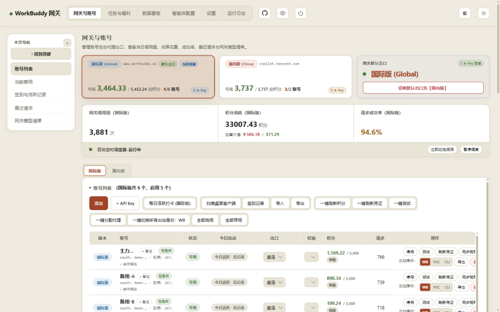
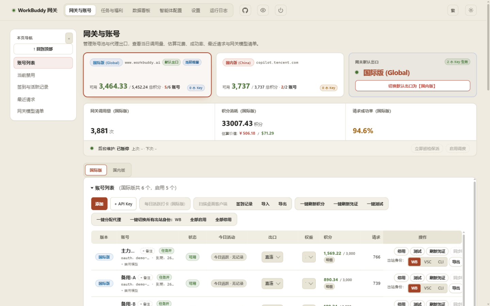
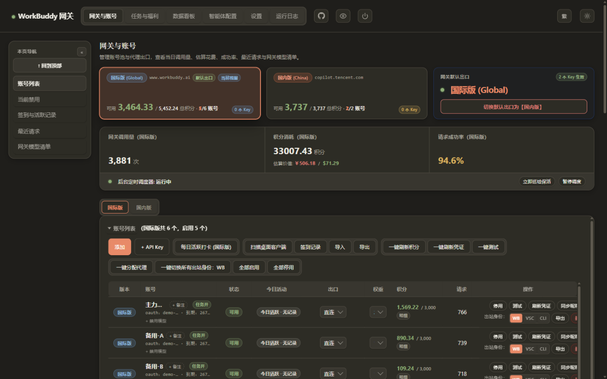
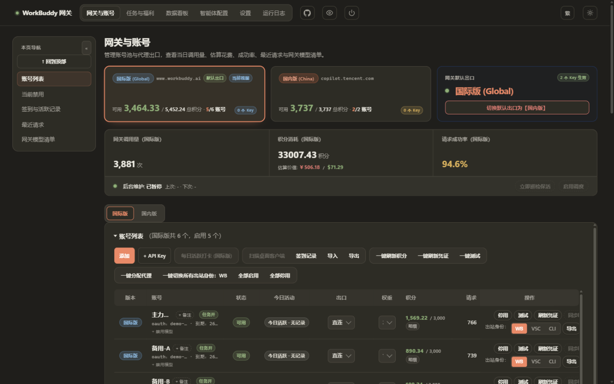
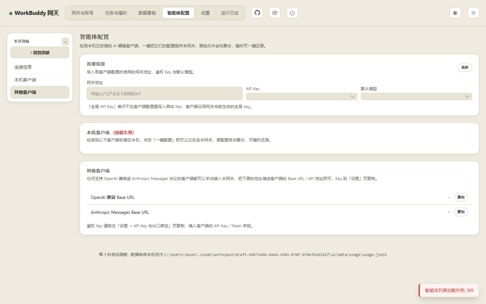
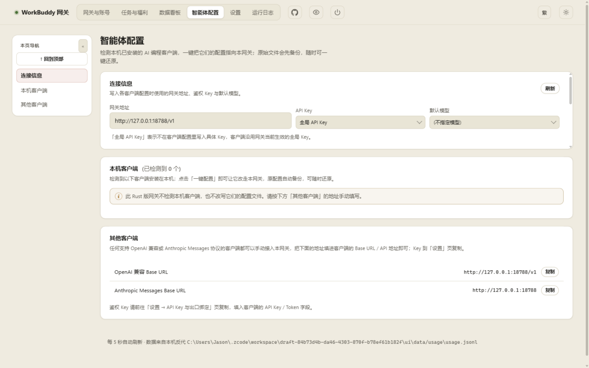

# 管理看板：界面改版说明

看板 HTML（`assets/dashboard.html`）原样取自 Python 基线，未作修改，方便以后和上游对比、合并。改版内容是叠在它后面的两层，由网关在渲染页面时插到 `</body>` 之前：

| 文件 | 作用 |
|---|---|
| `assets/ui/refresh.css` | 视觉改版：字体与字号层级、间距、卡片与面板、按钮与输入框、焦点环、表格、顶栏、弹窗、提示条、滚动条、窄屏 |
| `assets/ui/rust-build.js` | 标出 Rust 版没有实现的功能，并让这些按钮不可点 |

两者都在编译时嵌进二进制文件，运行时不读取磁盘。

## 截图

同一份演示数据，1440×900。左边是改版前（`rust-port` 分支的二进制），右边是改版后。

| 改版前 | 改版后 |
|---|---|
|  |  |
|  |  |
|  |  |

## 修复的问题

- **每次打开页面都会弹红色报错。** 看板会自动读取 `/tasks`、`/agents`、`/activity/history`、`/accounts/credits/grants`、`/updates/backups`、`/scheduler`，Rust 版对这些接口都返回 501，于是每次加载都弹「智能体列表加载失败: 501」「积分获取历史加载失败: 501」之类的提示。现在这些只读接口返回带 `"supported": false` 的空数据，页面显示为空。会改动数据的接口（领取任务、一键配置客户端、回滚版本等）仍然返回 501。
- **未实现的按钮点了才报错。** 每日活跃打卡、成长任务、扫描桌面客户端、同步昵称、一键配置客户端、自动发现代理、测试代理、立即查询额度、立即取价、检查更新、调度器开关等按钮，现在以虚线框、半透明的样子显示，不能点击，鼠标悬停时说明原因。任务与福利页、本机客户端区块顶部加了一行说明。
- **日志时间显示成浮点数**（`1793232342.124013`）。Rust 版日志条目的 `time` 字段是 epoch 秒，而看板按 Python 版的 `HH:MM:SS` 字符串直接显示。现已改成同样的格式，epoch 秒另放在 `at` 字段。
- **冷却时间显示成 `2160.2202s`。** `cooldownFor`、`restrictedFor` 等字段改为和 Python 版一样取整秒。
- **智能体页的 Base URL 显示为 `-`**，网关地址栏是空的，只显示占位文字 `127.0.0.1:8000`。原因是 `/agents` 返回 501，页面中断了填充。现在它返回模型列表和 API Key 列表，地址、Key、默认模型下拉框都能正常填出。
- **点过的页签、侧栏项出现一圈强调色边框。** 原样式里全局的 `button:hover` 会给所有按钮加上强调色边框，导航按钮也被波及。现在导航类按钮的悬停样式与主按钮分开。
- **手机上顶栏标题只剩几个字。** 原来日志、关机两个图标排在标题前面，把标题挤成了「WorkBuddy 网…」。现已调整顺序。

## 视觉调整

保留原有配色、三套主题风格（Claude / Material / MiuiX）和浅色/深色模式，只调整下面这些：

- 页面标题从 17px 衬线体改为 22px 无衬线体，与顶栏统一；区块标题去掉全大写和加宽字距。
- 卡片、面板改用更淡的边框和阴影，深色模式下不加阴影。当前选中的版本卡片由大面积底色改为细描边加淡底色。
- 按钮统一高度（32px，表格内保持紧凑），按下时轻微缩小（`scale(.97)`，160ms）。禁用状态有明确样式。
- 输入框、下拉框获得焦点时显示强调色焦点环。只有键盘操作才显示焦点框，鼠标点击不显示。
- 表头改成浅底、圆角，表格行悬停时变色。
- 提示条改为毛玻璃底和彩色圆点，出现时淡入；登录页卡片带入场动画。
- 滚动条变细，颜色跟随主题。
- 手机宽度下输入框字号为 16px，避免 iOS 自动放大页面；触控设备上不出现残留的悬停状态。
- 系统开启「减少动态效果」时，关闭所有动画。

## 验证

- 在 1440 / 1024 / 390 三种宽度下逐页检查：没有被截断的按钮，页面没有横向滚动条。
- 浅色和深色、简体 / 繁体 / English 都检查过。新增文字自带三种语言，切换语言时会更新。
- `cargo test`（259 项）、整机冒烟测试（39 项）、上游同步冒烟测试（10 项）全部通过。

## 已知未处理

- English 界面下仍有不少中文残留（如「今日活跃打卡状态」「补签卡余额」）。这是上游词典本来就缺的条目，改版前后一样，这次没有补。
- 数据看板页（`#pageAnalytics`）有自己的一套样式，这次只做了全局层面的统一（字体、按钮、滚动条），没有重做布局。
