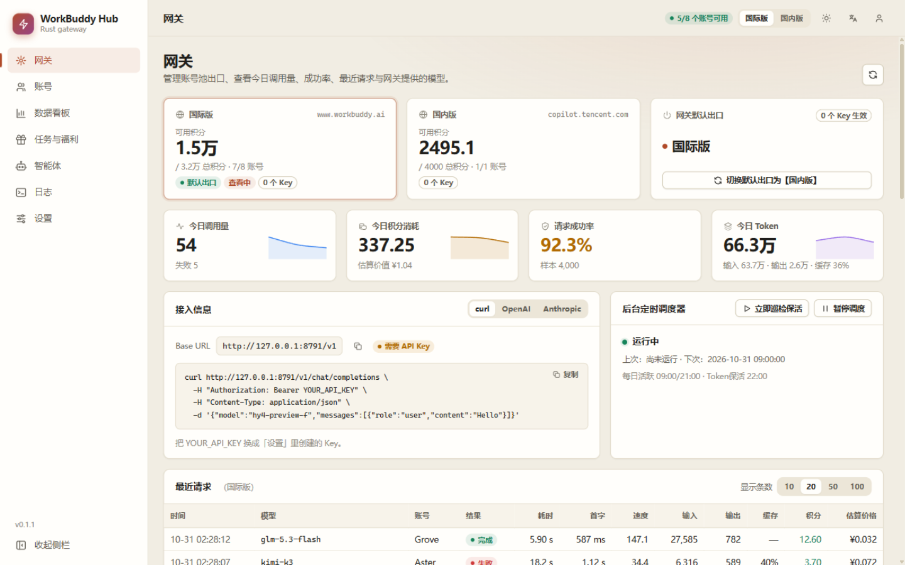
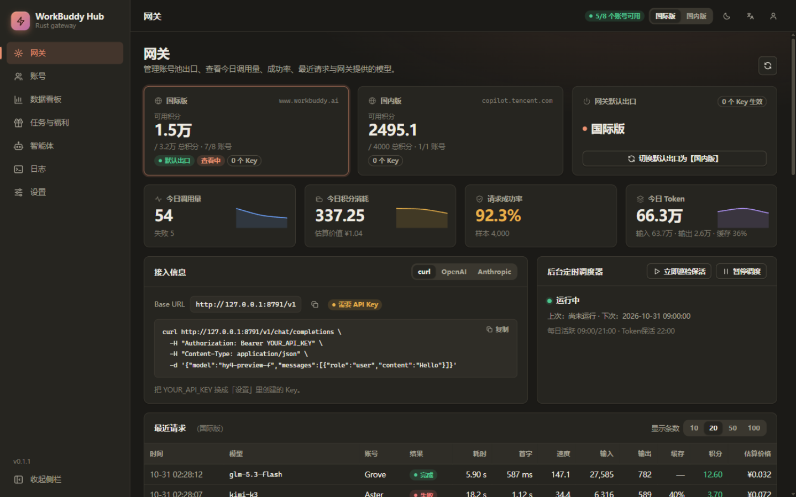
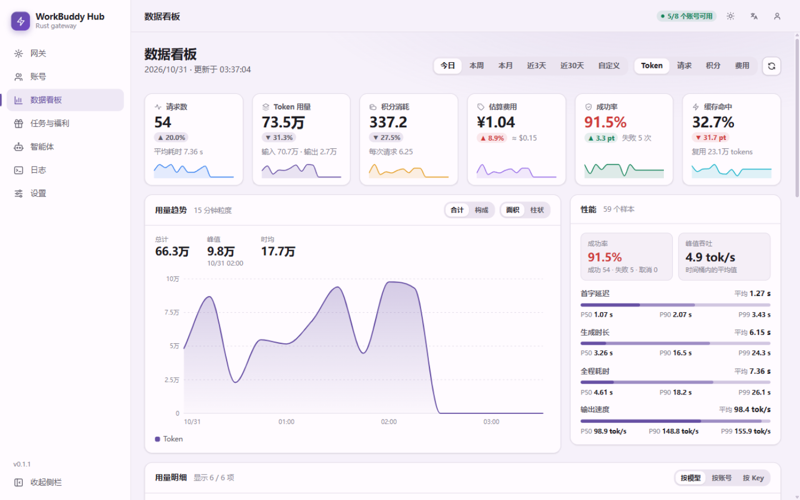
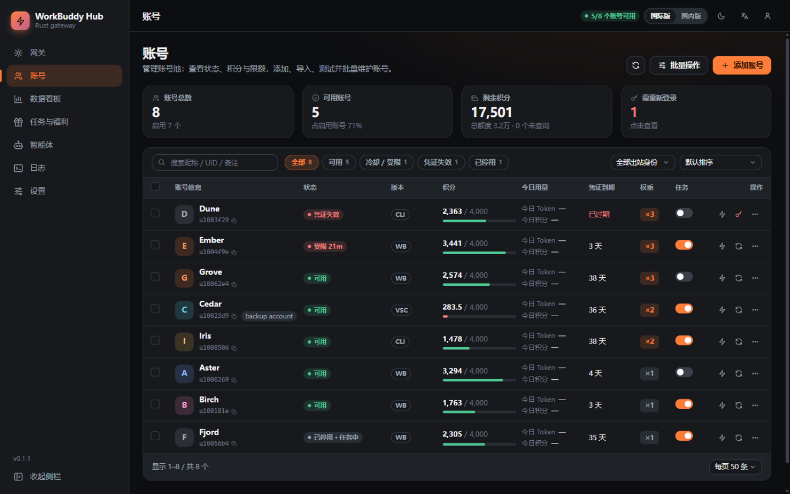

# 管理看板（`assets/web`）

看板是一组原生 HTML / CSS / ES 模块，没有构建步骤，也没有第三方依赖。`gateway/build.rs` 在编译时把 `assets/web` 下的所有文件嵌进二进制，运行时不读磁盘。

旧版是从 Python 基线原样搬来的单文件 `dashboard.html`（约 1 MB、1.8 万行），在 Chrome 上会偶发卡死。现在的看板是从零重写的，功能范围与旧版一致，Rust 版没有实现的功能显示为禁用。

| 浅色 · Claude 配色 | 深色 · Claude 配色 |
|---|---|
|  |  |
| **浅色 · Material 配色（数据看板）** | **深色 · MiuiX 配色（账号）** |
|  |  |

## 为什么旧版会卡死

- 页面上同时挂着 6 个以上监听 `document.body` 子树的 `MutationObserver`：整页文字翻译器、下拉框增强器、页内导航重建器等。每 5 秒一次的轮询会把整张表 `innerHTML` 重画，每次重画都触发这些观察者重新扫描整棵 DOM。
- 页内导航观察者监听 `style` / `class` 变化，而它自己的处理函数会改 `class`，存在自激。
- 每 5 秒并发请求三个会扫描整个用量日志的接口，另有 15 秒的账号轮询和 30 秒的调度器轮询；切到统计页后每一轮是七个请求。
- 所有页面的 DOM 和样式都在首屏一次性解析。

## 新版怎么避免

- 没有 `MutationObserver`，没有 `setInterval`，没有全页 DOM 扫描。语言切换时直接重画，不再事后改写文字。
- 轮询统一走 `js/lib/poll.js`：标签页隐藏时停，回到前台只刷新过期的数据；上一次没结束不会开始下一次；失败按指数退避；离开页面时中止在途请求。
- 列表用 `reconcile()` 按 key 增量更新，只改变化的单元格，数据没变就不碰 DOM。
- 页面按需加载（`import()`），首屏只下载外壳和当前页。鼠标移到导航项上时预热对应页面。
- 数据看板每 30 秒先请求一个小接口当变化探测，日志没增长就不请求大接口；请求 URL 按日历边界取整，服务端的 ETag / 304 才能命中。
- 图表是有节点数上限的 SVG；日志最多保留 1000 行；账号列表分页。没有 `backdrop-filter`，动画只用 `opacity` / `transform`。

### 实测对比

同一台机器、同一份演示数据（9 个账号、4,000 条用量），Chromium 内置浏览器，页面加载 6 秒后观察 30 秒。每项只测了一次，数字用于看量级。

| 指标 | 旧版 网关页 | 新版 网关页 | 旧版 数据看板 | 新版 数据看板 |
|---|---|---|---|---|
| DOM 节点数 | 4,334 | 1,262 | 5,280 | 1,248 |
| 30 秒内的请求数 | 27 | 9 | 51 | 2 |
| 长任务（>50 ms） | 4 个，最长 429 ms | 0 | 1 个，64 ms | 0 |
| 首屏传输（gzip） | 约 300 KB | 约 62 KB | | |

压力数据（300 个账号、6 万条用量、25 MB 日志）下逐页切换，七个页面都没有出现长任务。

## 目录

```
assets/web/
  index.html            外壳；内联脚本在首帧前设置主题，避免闪烁
  css/                  tokens（三套配色 × 深浅）→ base → layout → components → page-*.css
  js/main.js            启动、登录门、侧栏和顶栏、hash 路由
  js/lib/               dom、api、poll、i18n、theme、fmt、ui、chart、icons、ctx、shared
  js/i18n/hant.js       简体转繁体（只在选了正體中文时才下载）
  js/pages/<id>.js      每个页面一个入口，另有 <id>-*.js 辅助模块
tools/ui-dev.mjs        本地开发代理（见下）
```

`gateway/src/ui.rs` 负责提供这些文件：`/`、`/dashboard`、`/ui` 返回外壳（并注入实例默认语言），`/ui/app.css` 是按固定顺序拼接的样式，`/ui/js/**` 是各个模块。每个文件第一次被请求时计算 ETag 并 gzip，之后直接复用；响应带 `Cache-Control: no-cache`，浏览器靠 304 重新验证。

## 页面约定

```js
import { add, t } from '../lib/i18n.js';
add({ '保存': 'Save' });                    // 英文词典；源语言是简体中文
export const usesRealm = true;               // 为 true 时顶栏显示“查看区域”开关
export async function mount(root, app) {     // app = js/lib/ctx.js 的 ctx
  // 构建 DOM、启动 poller……
  return () => { /* 清理：停 poller、销毁图表、移除全局监听 */ };
}
```

- 所有可见文字写成 `t('简体中文')`。同一个中文词在不同语境下英文不同时，加语境后缀：`t('账号@@col')`（后缀不会显示）。
- 样式只用 `css/tokens.css` 里的变量，三套配色（Claude / Material / MiuiX）与深浅色自动适配。页面自己的样式放在 `css/page-<id>.css`，选择器以 `.p-<id>` 开头。
- 不要在页面里使用 `MutationObserver` 或 `setInterval`；不要把接口数据拼进 `innerHTML`。

## 开发

```bash
# 先启动一个网关（任意方式），默认 8788
node tools/ui-dev.mjs 8790 8788     # 然后打开 http://127.0.0.1:8790/
```

代理直接从磁盘读 `assets/web`，改完刷新即可，不需要重新编译。发布构建会重新嵌入这些文件。

提交前建议检查：

- `node --input-type=module --check < 文件.js` 检查语法。
- 每个 `t('…')` 都有英文条目，且同一个中文词在各页面的英文一致（字典是全局的，后加载的页面会覆盖先加载的）。
- 用 390 px 宽度看一遍：不应出现页面级横向滚动条。

## Rust 版未实现的功能

这些在看板里显示为禁用并带说明，不会点了再报 501：自更新（检查 / 安装 / 回滚）、配额扫描、在线调价、代理探测与自动发现、桌面客户端导入、一键配置本机客户端（智能体页改为提供可复制的接入示例）、若干旧版开关（见设置页中标记为“未实现”的项）。完整清单见 [MIGRATION.md](MIGRATION.md)。

## 与旧版的差别

- 导航从顶部页签改成左侧栏，窄屏时变成底部标签栏。
- 顶栏的“国际版 / 国内版”开关只决定看板显示哪个区域；网关的“默认出口”需要在网关页确认后才会改动，并保存到服务端。
- 旧版的布局开关 `accounts_separate_tab`、`section_max_height`、`accounts_collapsed`、`key_before_hidden` 已整体移除：设置页不再显示，服务端也不再保存它们（已有的 `settings.json` 在加载时会自动清掉这几个键）。`hidden_pages` 继续有效。
- 网关页的成功率改由 `/usage` 的 `requests` 与 `errors` 计算，不再请求体积很大的 `/usage/perf`（压力数据下单次约 880 KB）。
- 旧版把“今日”写在页面文案里，实际统计的是整个日志；新版的“今日”卡片确实按当天统计。
- 页面不再支持 `?pwd=` 自动登录，以免密码留在地址栏和历史记录里。`?tab=<页面>` 仍然可用。
